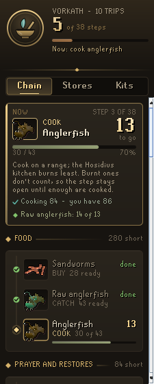
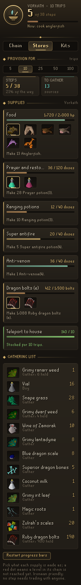
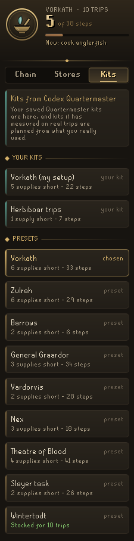

# Codex Provisioner

A RuneLite plugin that turns "I need supplies" into a list of things to do. Pick a kit, pick how many trips, and the Provisioner walks you through gathering and making everything it takes, one step at a time: catch the fish, cook them, gather the herbs, clean them, fill the vials, mix the unfinished potions, add the secondaries. It is built for ironmen, so nothing in the chain is bought from the Grand Exchange.

Part of the Codex suite, alongside Codex Quartermaster: kits you save in Quartermaster appear here, and kits it has measured on real trips are planned from what you really used.

  

## What it does

- **Chain tab.** The step in hand gets the most room: what to do, how many are left, a progress bar, the levels it asks for against yours, what goes in and how much of it you hold, and the tools to bring. Below it is every step, grouped by supply, from the first thing to gather to the finished potion, each with its state: done, ready, waiting on an earlier step, or locked behind a level.
- **Stores tab.** Provision for 5, 10, 25, 50 or 100 trips. Each supply shows how much of the target you hold. Where a supply can be made more than one way (anglerfish, sharks, karambwans, monkfish, swordfish or lobsters for food; prayer potions or super restores for prayer; ruby or diamond bolts), you pick, and a red dot marks a choice whose chain your levels don't reach yet. Left alone, it picks the best one you can make. A gathering list sums up everything still to collect.
- **Kits tab.** Your Codex Quartermaster kits, then nine presets (Vorkath, Zulrah, Barrows, General Graardor, Vardorvis, Nex, Theatre of Blood, a slayer task and Wintertodt), each with how many supplies are short and how many steps that takes.
- **It counts what you already hold at every stage.** A bank full of clean ranarr needs no grimy ones; vials of water you already filled are taken off. Shared inputs, like vials of water across several potions, appear once with the total.
- **The step in hand comes first.** Something you can make from what you hold beats gathering more, so a load of raw fish is cooked before the next is caught.
- **Steps shrink as you work.** The bank and inventory are counted as they change, so cleaning a herb ticks the bar along. Burnt fish don't count, so the cooking step stays open until enough are cooked.
- **Plaque.** An optional overlay in the game view with the step in hand, how many are left and its progress.
- **Chat line.** When a step finishes, an optional chat message says so and names the next step.

### Chains it knows

| Supply | Made as |
| --- | --- |
| Food | Anglerfish, shark, karambwan, monkfish, swordfish, lobster (catch, then cook) |
| Prayer | Prayer potion (ranarr, snape grass) or super restore (snapdragon, red spiders' eggs) |
| Saradomin brew | Toadflax, crushed bird nest |
| Ranging | Dwarf weed, wine of Zamorak |
| Magic | Lantadyme, potato cactus |
| Super combat | Torstol with 4-dose super attack (irit, eye of newt), strength (kwuarm, limpwurt) and defence (cadantine, white berries), decanted from 3-dose |
| Stamina | Super energy (avantoe, mort myre fungus) and amylase |
| Anti-venom | Antidote++ (coconut milk, irit, magic roots) and Zulrah's scales |
| Antifire / super antifire | Lantadyme and dragon scale dust; super antifire adds crushed superior dragon bones |
| Dragon bolts (e) | Ruby or diamond dragon bolts, enchanted ten at a time |

Anything else a kit carries, such as teleport tablets, is listed to stock as it is.

## How it works

The bank is read from `ItemContainerChanged` while it is open and remembered as last seen, so the panel works anywhere. The inventory, worn items (bolts in the ammo slot count) and rune pouch are read as they change, and levels come from `StatChanged`. Codex Quartermaster's saved kits and measured usage are read from its own RuneLite profile config; the Provisioner never writes to it. Its own state is stored per account in the RuneLite profile config as one compact entry.

It is guidance only. It does not automate any input, change menus, send any data off the client, or read or write files.

## Building

```
./gradlew build
```

`./gradlew run` starts a development client with the plugin loaded.

## License

BSD 2-Clause. See [LICENSE](LICENSE).
