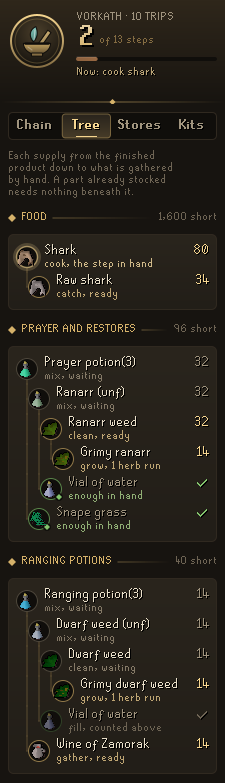
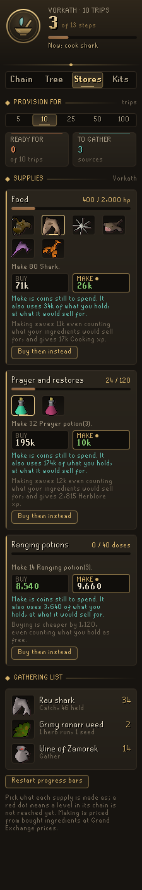
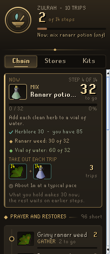
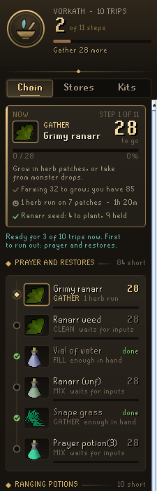

# Codex Provisioner

A RuneLite plugin that turns "I need supplies" into a list of things to do. Pick a kit, pick how many trips, and the Provisioner walks you through gathering and making everything it takes, one step at a time: catch the fish, cook them, gather the herbs, clean them, fill the vials, mix the unfinished potions, add the secondaries. Iron accounts are recognised and every step is made by hand; an account that can trade is shown, for each supply, whether buying it finished or making it is cheaper.

Part of the Codex suite, alongside Codex Quartermaster: kits you save in Quartermaster appear here, and kits it has measured on real trips are planned from what you really used. With Codex Bank Steward sharing its bank, the Provisioner starts from the bank it saw, so a fresh install needs no bank visit first.

<p align="center">
  
  
  
  
</p>

<p align="center">
  
  
  
</p>

## What it does

- **Chain tab.** The step in hand gets the most room: what to do, how many are left, a progress bar, the levels it asks for against yours, what goes in and how much of it you hold, and the tools to bring. Below it is every step, grouped by supply, from the first thing to gather to the finished potion, each with its state: done, ready, waiting on an earlier step, or locked behind a level.
- **Tree tab.** Each supply drawn as the tree it is: the finished potion or fish at the top and, branching beneath it on gilt lines, everything that goes into it, down to what you gather by hand. Every part shows its picture ringed in its state's colour (the step in hand glows, ready in gold, waiting faint, locked in red, stocked with a green seal), what is done to it and how many are still to get. A part you already hold enough of is a leaf, since nothing beneath it is needed, and a part two potions share, such as vials of water, is opened once and named again where it comes back. Herbs still to grow say how many herb runs they take. Hover a tree for all of it in words.
- **Stores tab.** Provision for 5, 10, 25, 50 or 100 trips. Each supply shows how much of the target you hold. Where a supply can be made more than one way (anglerfish, sharks, karambwans, monkfish, swordfish or lobsters for food; prayer potions or super restores for prayer; ruby or diamond bolts), you pick, and a red dot marks a choice whose chain your levels don't reach yet. Left alone, it picks the best one you can make. A gathering list sums up everything still to collect.
- **Kits tab.** Your Codex Quartermaster kits, then nine presets (Vorkath, Zulrah, Barrows, General Graardor, Vardorvis, Nex, Theatre of Blood, a slayer task and Wintertodt), each with how many supplies are short and how many steps that takes.
- **It counts what you already hold at every stage.** A bank full of clean ranarr needs no grimy ones; vials of water you already filled are taken off. Shared inputs, like vials of water across several potions, appear once with the total.
- **The step in hand comes first.** Something you can make from what you hold beats gathering more, so a load of raw fish is cooked before the next is caught.
- **Steps shrink as you work.** The bank and inventory are counted as they change, so cleaning a herb ticks the bar along. Burnt fish don't count, so the cooking step stays open until enough are cooked.
- **Potion storage counts.** Doses in the bank's potion storage are read the same way Codex Quartermaster reads them, so stored prayer doses are not made again. Until the Provisioner has seen the storage itself, it uses Quartermaster's last reading.
- **Buy or make.** For accounts that can trade, each supply on the Stores tab shows what it costs bought finished against made at Grand Exchange prices (each ingredient bought or made, whichever is cheaper), the experience making gives, and, when making costs more, the coins each point costs. Ingredients you already hold are used first and cost no coins, so Make shows only the coins still to spend; what comes out of your bank is said apart, at what it would sell for after the exchange's tax. Buy or make is judged on both, since buying finished leaves those ingredients to sell, and when the coins alone say otherwise the card says so. One button buys the supply instead, which turns its whole chain into one buying step; another goes back to making it. Iron accounts see none of this.
- **Each trip to the bank.** The step in hand shows one inventory as bank slots: fourteen unfinished potions and fourteen snape grass, twenty-eight grimy herbs, twenty-seven antidotes with a stack of scales, and how many trips the step has left. A tool takes a slot and a stack takes one however big it is. With the bank open, what to take out is outlined in teal with how many of each, and the tools to bring (*Mark items in the bank*, on by default).
- **What it trains.** The Chain tab adds up the experience every open step gives, skill by skill, with the level each skill stands at now and the level it ends at once the chain is done.
- **Time left on every step.** Each open step shows roughly how long it has left, and the Chain tab adds it all up. The Provisioner watches the steps shrink as you work and, once it has seen enough, uses your own pace (shown in teal on the step in hand); before that it uses a typical rate. Steps that cannot be timed, such as farm runs, drops and shop runs, are left out of the total and counted separately.
- **In one sitting.** Pick 30 minutes, an hour, two or three, and the Chain tab lists what that sitting gets through at your pace: the step in hand first, then the chain in order, each step as far as the time and its inputs allow, so a load is only cooked once it has been caught. What it cannot reach, and why (another sitting, herbs still to grow, a level still to train), is said under it.
- **Ready for how many trips.** Under the step in hand, and as a tile on the Stores tab, the Provisioner says how many whole trips what you hold already covers and which supply runs out first: "Ready for 3 of 10 trips now. First to run out: prayer and restores." Kits on the Kits tab say the same. You can stop at any point and go.
- **Herb runs.** Herbs still to grow are planned as herb runs instead of being left untimed: how many runs your patches take, how long they need to grow (80 minutes a run), and how many seeds that plants against the seeds in your bank. Different herbs share a run. Set how many patches you run and how many herbs a patch gives you in the settings; 0 patches leaves herbs untimed.
- **Plaque.** An optional overlay in the game view with the step in hand, how many are left and its progress (*Step plaque*).
- **Chat line.** When a step finishes, a chat message says so and names the next step (*Steps in chat*).
- **Low stock at the bank.** Once you have picked a kit, open the bank with supplies for fewer trips of it than the *Low stock warning* setting (3 by default) and a chat line says how many trips you are ready for, which supply runs out first and how many more of it would cover the mark: "Ready for 2 trips of Vorkath. First to run out: prayer and restores; 2 more prayer potion(3) cover 3 trips." It waits a moment for the potion storage to be counted, and while you work through the chain at the bank it only speaks again if you fall further behind or half an hour has passed. Set it to 0 to turn it off.

### Chains it knows

| Supply | Made as |
| --- | --- |
| Food | Anglerfish, shark, karambwan, monkfish, swordfish, lobster (catch, then cook) |
| Prayer | Prayer potion (ranarr, snape grass) or super restore (snapdragon, red spiders' eggs) |
| Saradomin brew | Toadflax, crushed bird nest |
| Ranging | Dwarf weed, wine of Zamorak |
| Magic | Lantadyme, potato cactus |
| Super combat | Torstol with 4-dose super attack (irit, eye of newt), strength (kwuarm, limpwurt) and defence (cadantine, white berries), decanted from 3-dose |
| Stamina | Super energy (avantoe, mort myre fungus) and amylase |
| Anti-venom | Antidote++ (coconut milk, irit, magic roots) and Zulrah's scales |
| Antifire / super antifire | Lantadyme and dragon scale dust; super antifire adds crushed superior dragon bones |
| Dragon bolts (e) | Ruby or diamond dragon bolts, enchanted ten at a time |

Anything else a kit carries, such as teleport tablets, is listed to stock as it is.

## Settings that matter

- **Step plaque** and **Steps in chat** (both on): the plaque in the game view, and the chat line when a step is done.
- **Plan from measured trips** (on): plan a Codex Quartermaster kit from what you really used on its measured trips rather than its own amounts.
- **Mark items in the bank** (on): outline what the step in hand needs for one inventory while the bank is open.
- **Herb patches** and **Herbs per patch**: how many patches you run and what one gives you, for the herb runs; 0 patches leaves herbs untimed.
- **Low stock warning** (3 trips): the chat line at the bank when your kit's supplies run low; 0 turns it off.

## With other Codex plugins

The Provisioner works on its own with its nine presets. When these are installed too, it reads their saved data, never writes it, and works the same if they are removed:

- **Codex Quartermaster**: your saved kits, the kit you last picked, what each kit really used on measured trips, and its reading of your potion storage.
- **Codex Bank Steward**: its shared copy of your bank, so a fresh install plans from your bank before you open it.

A damaged save from any of them, or of the Provisioner's own (a figure of the wrong kind or too big, a file cut short), never stops the panel: whatever still reads is used, the rest left out, and a damaged save of its own is set aside in your profile before it is written over.

## How it works

The bank is read from `ItemContainerChanged` while it is open and remembered as last seen, so the panel works anywhere; its potion storage is read with the game's own dose script while the bank is open. Prices come from RuneLite's item manager. Your pace is learned from small, steady drops in a step's count with no break longer than two minutes; a big jump, such as a bank first seen, teaches nothing, and neither does anything that arrives by trade, however small: nothing is learned while a shop, trade or Grand Exchange window is open, an item the exchange buys for you is marked so its arrival is passed over when you collect it, and buying steps are never timed. The inventory, worn items (bolts in the ammo slot count) and rune pouch are read as they change, and levels come from `StatChanged`. Codex Quartermaster's kits and measured usage are read from the kits it publishes for other plugins (`codexquartermaster/kitsV1`), with its own saved entry (`quarters`) read only for what that leaves out (the number of trips measured and its potion storage reading) or when Quartermaster is too old to publish. Codex Bank Steward's shared bank (`codexbanksteward/bankV1`) is taken only when it is newer than the bank the Provisioner saw itself, by more than a minute; taking it finishes no step in the chat and teaches no pace. The Provisioner never writes to either plugin's config, and works the same without them. Its own state is stored per account in the RuneLite profile config as one compact entry.

It is guidance only. It does not automate any input, change menus, send any data off the client, or read or write files.

## Building

```
./gradlew build
```

`./gradlew run` starts a development client with the plugin loaded.

## License

BSD 2-Clause. See [LICENSE](LICENSE).
